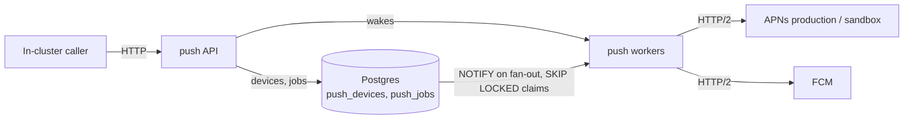

# Push

Sends APNs and FCM push notifications. It runs as the `push` Deployment in the `main` namespace and
is reachable only inside the cluster at `http://push.main.svc.cluster.local`.



## API

| Method   | Path                  | Body                                                                   | Response                   |
| -------- | --------------------- | ---------------------------------------------------------------------- | -------------------------- |
| `PUT`    | `/devices/{token}`    | `{"platform", "apns_environment", "app", "user_id", "kind"}`           | `204`                      |
| `DELETE` | `/devices/{token}`    |                                                                        | `204`                      |
| `POST`   | `/notifications`      | `{"app", "push_type", "user_ids", "tokens", "apns", "fcm", "send_at"}` | `201 {"id"}`               |
| `DELETE` | `/notifications/{id}` |                                                                        | `204`, or `404` once taken |

- `platform` is `ios` (raw APNs token) or `android` (FCM token). iOS devices need
  `apns_environment`: `sandbox` for development-signed builds, `production` otherwise. `app` is the
  bundle ID or package name and is the APNs topic. `kind` is `device` or `liveactivity` for Live
  Activity push-to-start and update tokens.
- `push_type` is `alert`, `background`, or `liveactivity`. `liveactivity` sends only to
  `liveactivity` tokens with topic `<app>.push-type.liveactivity`; the others send only to `device`
  tokens. `background` sends with APNs priority 5.
- A notification goes to every registered token of `user_ids`, or to the registered `tokens`, now or
  at `send_at`; it can't set both. `apns` is the APNs JSON payload sent as is, and `fcm` is the FCM
  v1 `message` without `token`. iOS tokens are skipped without `apns` and Android tokens without
  `fcm`.
- Cancelling removes the parts of a notification no worker has taken yet. A taken part still goes
  out, retries included.

```sh
curl -X PUT http://push.main.svc.cluster.local/devices/$TOKEN -d '{
  "platform": "ios", "apns_environment": "production", "kind": "device",
  "app": "com.pandoks.app", "user_id": "42"
}'
curl -X POST http://push.main.svc.cluster.local/notifications -d '{
  "app": "com.pandoks.app", "push_type": "alert", "user_ids": ["42"],
  "apns": {"aps": {"alert": {"title": "Hi"}}},
  "fcm": {"notification": {"title": "Hi"}},
  "send_at": "2026-11-01T09:00:00Z"
}'
```

## Delivery

- A notification is split into jobs in Postgres so a fan-out spreads across every replica. A worker
  holds its job's row lock while sending and deletes the job when it commits, so delivery is at
  least once: a replica that dies mid-job leaves the job to another worker, which sends it again. A
  stopping replica starts no more sends and requeues the tokens it hasn't sent before committing.
- A worker claims due jobs until it holds 500 recipients and starts each job's sends as soon as it
  claims it, so a burst of small notifications goes out together while a fan-out's full jobs still
  spread across replicas.
- Each pod opens at most 5 Postgres connections: 3 workers hold one each for their batch, LISTEN
  holds one, and the API always has the last one plus any idle worker's. A rollout overlaps up to 4
  pods, so push stays within 20 of the 25 connections PgDog leaves free.
- Database calls time out after 5 seconds, and `GET /readyz` fails while Postgres is unreachable.
- APNs `429` and `5xx` and FCM `429` and `5xx` are retried 4 times with exponential backoff that
  honors FCM's `Retry-After`; APNs sends none. As the providers ask, the first retry waits at least
  15 minutes after an APNs `5xx`, a minute after an FCM `429`, and 10 seconds after an FCM `5xx`.
- Tokens APNs reports as `410` or `BadDeviceToken` are deleted, and so are FCM tokens reported as
  `UNREGISTERED`, or as `INVALID_ARGUMENT` when another token took the same message. A device that
  registered again while the job ran keeps its token.

## Setup

It reads `AppleTeamId`, `AppleApnsKeyId`, `AppleApnsKey` (the `.p8` contents), and
`FirebaseServiceAccountJson` from [infra/secrets.ts](/infra/secrets.ts). Every stage needs them set:

```sh
pnpm sst secret set AppleApnsKey --stage <stage> < AuthKey_XXXXXXXXXX.p8
```

## Development

| Command            | Description                                       |
| ------------------ | ------------------------------------------------- |
| `pnpm local:build` | Builds the image as `localhost:12345/push:latest` |
| `pnpm local:push`  | Pushes the image to the local k3d registry        |
| `pnpm test`        | Runs the tests against real Postgres              |

The tests run the service against fake APNs and FCM servers and need Postgres (`PG*` variables):

```sh
docker run -d --rm --name push-postgres -e POSTGRES_PASSWORD=postgres -p 5432:5432 postgres:18
PGHOST=localhost PGUSER=postgres PGPASSWORD=postgres pnpm test
```
