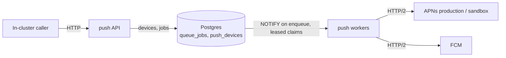

# Push

Sends APNs and FCM push notifications. It runs as the `push` Deployment in the `main` namespace and
is reachable only inside the cluster at `http://push.main.svc.cluster.local`.



## API

| Method   | Path                  | Body                                                                   | Response                              |
| -------- | --------------------- | ---------------------------------------------------------------------- | ------------------------------------- |
| `PUT`    | `/devices/{token}`    | `{"platform", "apns_environment", "app", "user_id", "kind"}`           | `204`                                 |
| `DELETE` | `/devices/{token}`    |                                                                        | `204`                                 |
| `POST`   | `/notifications`      | `{"app", "push_type", "user_ids", "tokens", "apns", "fcm", "send_at"}` | `201 {"id"}`                          |
| `DELETE` | `/notifications/{id}` |                                                                        | `204`, or `404` if no part is waiting |

- `platform` is `ios` (raw APNs token) or `android` (FCM token). iOS devices need
  `apns_environment`: `sandbox` for development-signed builds, `production` otherwise. `app` is the
  bundle ID or package name and is the APNs topic. `kind` is `device` or `liveactivity` for Live
  Activity push-to-start and update tokens.
- `push_type` is `alert`, `background`, or `liveactivity`. `liveactivity` sends only to
  `liveactivity` tokens with topic `<app>.push-type.liveactivity`; the others send only to `device`
  tokens. `background` sends with APNs priority 5.
- A notification goes to every registered token of `user_ids`, or to the registered `tokens`, now or
  at `send_at`; it can't set both. `apns` is the APNs JSON payload sent as is, and `fcm` is the FCM
  v1 `message` without `token`. iOS tokens are skipped without `apns` and Android tokens without
  `fcm`.
- Cancelling removes the parts of a notification no worker is sending, retries waiting out their
  backoff included. A part being sent still goes out.

```sh
curl -X PUT http://push.main.svc.cluster.local/devices/$TOKEN -d '{
  "platform": "ios", "apns_environment": "production", "kind": "device",
  "app": "com.pandoks.app", "user_id": "42"
}'
curl -X POST http://push.main.svc.cluster.local/notifications -d '{
  "app": "com.pandoks.app", "push_type": "alert", "user_ids": ["42"],
  "apns": {"aps": {"alert": {"title": "Hi"}}},
  "fcm": {"notification": {"title": "Hi"}},
  "send_at": "2026-11-01T09:00:00Z"
}'
```

## Delivery

- A notification is split into jobs of at most 500 recipients on the `push` queue of
  [packages/queue](/packages/queue), grouped by notification ID, so a fan-out spreads across every
  replica. Each pod runs 3 jobs at a time under a 30-second lease that it renews while sending.
  Delivery is at least once: a replica that dies mid-job leaves the job to another worker once the
  lease runs out, within 30 seconds, and that worker sends it again. A stopping replica starts no
  more sends and requeues the tokens it hasn't sent.
- A job ends in one transaction that deletes unregistered tokens, requeues retries as new jobs, and
  completes the job. If that fails, the queue runs the whole job again after 1, 2, 4, and 8 seconds,
  then marks it dead in `queue_jobs`.
- Each pod opens at most 5 Postgres connections: LISTEN holds one, and workers use the rest only to
  claim, heartbeat, and finish a job, never across sends, so the API keeps one. A rollout overlaps
  up to 4 pods, so push stays within 20 of the 25 connections PgDog leaves free.
- Database calls time out after 5 seconds, and `GET /readyz` fails while Postgres is unreachable.
- APNs `429` and `5xx` and FCM `429` and `5xx` are retried 4 times with exponential backoff, or
  after FCM's `Retry-After` as given if that's longer; APNs sends none. The first retry waits at
  least a minute after an APNs `5xx` or FCM `429` and 10 seconds after an FCM `5xx` or a failed
  connection. A send whose next retry would wait over 8 minutes fails instead, so a stale alert is
  dropped and an APNs `5xx` stops retrying after 15 minutes. A retry of a `user_ids` notification
  skips a token registered to another user meanwhile.
- Tokens APNs reports as `410` or `BadDeviceToken` are deleted, and so are FCM tokens reported as
  `UNREGISTERED`, or as `INVALID_ARGUMENT` when another token took the same message. A device that
  registered again while the job ran keeps its token.

## Setup

It reads `AppleTeamId`, `AppleApnsKeyId`, `AppleApnsKey` (the `.p8` contents), and
`FirebaseServiceAccountJson` from [infra/secrets.ts](/infra/secrets.ts). Every stage needs the Apple
ones set:

```sh
pnpm sst secret set AppleApnsKey --stage <stage> < AuthKey_XXXXXXXXXX.p8
```

Each deploy sets `FirebaseServiceAccountJson` to a key of the `push` service account that
[infra/firebase.ts](/infra/firebase.ts) creates with `roles/firebasecloudmessaging.admin`, in the
Google Cloud project `pandoks-prod` for production and `pandoks-dev` for every other stage. Create
both projects by hand in the [console](https://console.cloud.google.com/projectcreate), since a
service account can't create projects without an organization. Deploying another stage needs Google
credentials:

```sh
gcloud auth application-default login
gcloud auth application-default set-quota-project pandoks-dev
```

Production deploys from CI authenticate through Workload Identity Federation, which can't create
itself from CI. Before the first `main` deploy with `infra/firebase.ts`, create it once as a project
owner; that deploy imports these resources:

```sh
gcloud auth login
gcloud services enable cloudresourcemanager.googleapis.com iam.googleapis.com \
  iamcredentials.googleapis.com sts.googleapis.com --project pandoks-prod
gcloud iam workload-identity-pools create github --project pandoks-prod --location global
gcloud iam workload-identity-pools providers create-oidc github --project pandoks-prod \
  --location global --workload-identity-pool github \
  --issuer-uri https://token.actions.githubusercontent.com \
  --attribute-mapping google.subject=assertion.sub \
  --attribute-condition "assertion.sub in ['repo:Pandoks/pandoks.com:environment:production', 'repo:Pandoks/pandoks.com:ref:refs/heads/main']"
gcloud iam service-accounts create github-actions --project pandoks-prod
gcloud projects add-iam-policy-binding pandoks-prod --role roles/owner \
  --member serviceAccount:github-actions@pandoks-prod.iam.gserviceaccount.com
gcloud iam service-accounts add-iam-policy-binding \
  github-actions@pandoks-prod.iam.gserviceaccount.com --project pandoks-prod \
  --role roles/iam.workloadIdentityUser \
  --member "principalSet://iam.googleapis.com/projects/$(gcloud projects describe pandoks-prod --format 'value(projectNumber)')/locations/global/workloadIdentityPools/github/*"
gh variable set GCP_WORKLOAD_IDENTITY_PROVIDER --body "$(gcloud iam workload-identity-pools \
  providers describe github --project pandoks-prod --location global \
  --workload-identity-pool github --format 'value(name)')"
gh variable set GCP_SERVICE_ACCOUNT --body github-actions@pandoks-prod.iam.gserviceaccount.com
```

## Development

| Command            | Description                                       |
| ------------------ | ------------------------------------------------- |
| `pnpm local:build` | Builds the image as `localhost:12345/push:latest` |
| `pnpm local:push`  | Pushes the image to the local k3d registry        |
| `pnpm test`        | Runs the tests against real Postgres              |

The tests run the service against fake APNs and FCM servers and need Postgres (`PG*` variables):

```sh
docker run -d --rm --name push-postgres -e POSTGRES_PASSWORD=postgres -p 5432:5432 postgres:18
PGHOST=localhost PGUSER=postgres PGPASSWORD=postgres pnpm test
```
