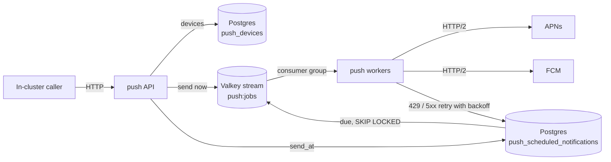

# Push

Sends APNs and FCM push notifications. It runs as the `push` Deployment in the `main` namespace and
is reachable only inside the cluster at `http://push.main.svc.cluster.local`.



## API

| Method   | Path                  | Body                                                                   | Response                              |
| -------- | --------------------- | ---------------------------------------------------------------------- | ------------------------------------- |
| `PUT`    | `/devices/{token}`    | `{"platform", "app", "user_id", "kind"}`                               | `204`                                 |
| `DELETE` | `/devices/{token}`    |                                                                        | `204`                                 |
| `POST`   | `/notifications`      | `{"app", "push_type", "user_ids", "tokens", "apns", "fcm", "send_at"}` | `202`, or `201 {"id"}` with `send_at` |
| `DELETE` | `/notifications/{id}` |                                                                        | `204`, or `404` once sent             |

- `platform` is `ios` (raw APNs token) or `android` (FCM token). `app` is the bundle ID or package
  name and is the APNs topic. `kind` is `device` (default) or `liveactivity` for Live Activity
  push-to-start and update tokens.
- `push_type` is `alert`, `background`, or `liveactivity`. `liveactivity` sends only to
  `liveactivity` tokens with topic `<app>.push-type.liveactivity`; the others send only to `device`
  tokens. `background` sends with APNs priority 5.
- A notification goes to every registered token of `user_ids` plus the registered `tokens`. `apns`
  is the APNs JSON payload sent as is, and `fcm` is the FCM v1 `message` without `token`. iOS tokens
  are skipped without `apns` and Android tokens without `fcm`.

```sh
curl -X PUT http://push.main.svc.cluster.local/devices/$TOKEN \
  -d '{"platform":"ios","app":"com.pandoks.app","user_id":"42"}'
curl -X POST http://push.main.svc.cluster.local/notifications -d '{
  "app": "com.pandoks.app", "push_type": "alert", "user_ids": ["42"],
  "apns": {"aps": {"alert": {"title": "Hi"}}},
  "fcm": {"notification": {"title": "Hi"}},
  "send_at": "2026-11-01T09:00:00Z"
}'
```

## Delivery

- The API splits recipients into stream jobs of 500 users or tokens, so a fan-out spreads across
  every replica. Each replica runs 32 job workers and up to 1000 concurrent sends over at most 8
  long-lived HTTP/2 connections per provider. A job left pending by a dead replica is reclaimed
  after 5 minutes.
- APNs uses token auth: an ES256 JWT signed with the `.p8` key, reused for 50 minutes. FCM uses an
  OAuth2 token from the service account, cached until it expires.
- Tokens APNs reports as `410` or `BadDeviceToken`, and FCM as `UNREGISTERED`, are deleted unless
  the device registered again while the job ran.
- APNs `429` and `5xx`, and FCM `429` and `5xx`, are retried up to 5 attempts through the scheduled
  table with exponential backoff that honors `Retry-After` (at least 1 minute for FCM `429`).
- Every replica polls due scheduled notifications each second. Delivery is at least once: a crash
  between sending and acknowledging a job resends it.
- The `main` Valkey runs without persistence, so a Valkey restart drops queued jobs (scheduled ones
  live in Postgres); workers recreate the consumer group and carry on.

## Setup

The service connects to the `main` Postgres (through PgDog) and Valkey clusters as `admin` and
creates its tables on startup. The Postgres initializer grants `admin` nothing in the application
database, so grant it once on a new cluster:

```sh
kubectl exec -n main patroni-main-shard-0-0 -c patroni -- \
  psql -U postgres -d main -c 'GRANT CREATE ON SCHEMA public TO admin;'
```

It reads `AppleTeamId`, `AppleApnsKeyId`, `AppleApnsKey` (the `.p8` contents), and
`FirebaseServiceAccountJson` from [infra/secrets.ts](/infra/secrets.ts). Every stage needs them set:

```sh
pnpm sst secret set AppleApnsKey --stage <stage> < AuthKey_XXXXXXXXXX.p8
```

APNs goes to `https://api.push.apple.com`, so tokens from development-signed builds are rejected as
`BadDeviceToken`.

## Development

| Command            | Description                                       |
| ------------------ | ------------------------------------------------- |
| `pnpm local:build` | Builds the image as `localhost:12345/push:latest` |
| `pnpm local:push`  | Pushes the image to the local k3d registry        |
| `pnpm test`        | Runs the tests against real Postgres and Valkey   |

The tests run the service against fake APNs and FCM servers and need Postgres (`PG*` variables) and
Valkey (`VALKEY_ADDRESS`):

```sh
docker run -d --rm --name push-postgres -e POSTGRES_PASSWORD=postgres -p 5432:5432 postgres:18
docker run -d --rm --name push-valkey -p 6379:6379 valkey/valkey:9-alpine
PGHOST=localhost PGUSER=postgres PGPASSWORD=postgres VALKEY_ADDRESS=localhost:6379 pnpm test
```
