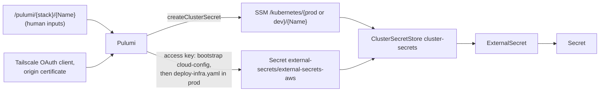

# K3s

This is the k8s cluster that hosts most of the applications in this monorepo. The applications that
are not hosted in this cluster are hosted either in AWS or Cloudflare usually for serverless
applications. For databases, it is better to use a managed database as it reduces the operational
overhead.

As it stands, the dev and prod clusters are hosted on Hetzner VPS's.

## Directory Structure

```
k3s/
  bootstrap/                 # Helm charts + CRD providers (deploy <env> --bootstrap)
    core/                    # MetalLB, cert-manager, External Secrets Operator, kube-prometheus-stack, HAProxy ingress
    local/                   # core
    dev/                     # core + system-upgrade-controller CRDs
    prod/                    # core + ArgoCD + system-upgrade-controller CRDs
  base/                      # Shared resources for every environment
    core/                    # MetalLB pool, cert-manager issuers, shared ClusterRoles, Grafana ExternalSecret
    apps/                    # References to apps/*/kube
    monitoring/              # HAProxy Grafana dashboards
  overlays/                  # deploy <env> (includes base + bootstrap/<env>)
    local/                   # k3d: placeholder secret store, MetalLB docker IPs, k3d etcd endpoints, apps/*/kube/dev-patch.yaml
    cluster/                 # Shared by dev + prod: AWS secret store, Tailscale operator, system upgrades, Hetzner etcd endpoints
    dev/                     # cluster + bootstrap/dev
    prod/                    # cluster + bootstrap/prod + prod patches, ArgoCD plugin and Application
```

`pnpm cluster deploy` substitutes only the image variables (see
[scripts/cluster/README.md](../scripts/cluster/README.md)); manifests hold `dev` names and buckets,
and `overlays/prod` patches them to `prod`.

## Secrets

Every credential in the cluster is an `ExternalSecret` that
[External Secrets Operator](https://external-secrets.io) syncs from the `cluster-secrets`
`ClusterSecretStore`, keeping the `Secret` names and keys the apps read:



- **dev and prod** (`overlays/cluster/cluster-secrets.yaml`): the AWS Parameter Store provider reads
  `/kubernetes/dev/<Name>` (`/kubernetes/prod/` in prod) as the stack's `external-secrets-<stack>`
  IAM user, which can only read and decrypt that path.
- **local** (`overlays/local/cluster-secrets.yaml`): the `fake` provider serves committed
  placeholders, so k3d needs no AWS login or Pulumi stack.

To add one, write an `ExternalSecret` whose `remoteRef.key` is the name, publish it with
`createClusterSecret` in `infra/kubernetes.ts`, and add a placeholder to the local store if the
`local` overlay renders it. A missing key leaves the `ExternalSecret` not Ready and keeps the last
synced `Secret`.

ExternalSecrets refresh hourly; to sync a changed value now:

```sh
kubectl -n <namespace> annotate externalsecret <name> force-sync="$(date +%s)" --overwrite
```

Grafana reads its admin password only when it first creates its database, so change it in Grafana
too.

### Rotating the External Secrets access key

Rename `ExternalSecretsAccessKey` in `infra/kubernetes.ts` and merge; this rotates every stack's
key. The bootstrap node's cloud-config writes `external-secrets/external-secrets-aws` on first boot:

- **prod** ignores user-data changes, so after every `pulumi up`, `deploy-infra.yaml` writes the
  stack's key into that Secret. Pulumi creates the new key before deleting the old one, so syncs can
  fail only in the seconds between, and Secrets keep their last values.
- **other stacks**: the user data changes, so the next `pulumi up --stack <stack>` replaces every
  server and rebuilds the cluster, wiping its data, with the new key. To rotate just one, run
  `pulumi up --stack <stack> --target-replace <urn>` (URN from
  `pulumi stack --stack <stack> --show-urns`) instead of renaming.

## Local Development

For local development, we use [k3d](https://k3d.io/) to create a local k3s cluster.

To setup the cluster, run the following commands from the root of the project:

```sh
pnpm local:init
```

Or step by step:

```sh
# Start docker compose dependencies (creates pandoks-net network)
./scripts/cluster/main.sh k3d deps up

# Create k3d cluster
./scripts/cluster/main.sh k3d up

# Build and push images/helm charts to the local registry
pnpm local:build && pnpm local:push

# Install base infrastructure (helm charts + CRDs)
./scripts/cluster/main.sh deploy local --bootstrap

# Deploy local overlay (placeholder secret store, MetalLB IP patch, app dev patches)
./scripts/cluster/main.sh deploy local
```

## Cloud Clusters

The dev and prod clusters are provisioned by Pulumi (`infra/vps`) with cloud-config that bootstraps
k3s + tailscale. The tailscale operator provides secure access to the cluster API without needing
SSH tunnels.

```sh
# Connect via tailscale (cluster appears as <stage>-cluster in your tailnet)
tailscale configure kubeconfig <stage>-cluster
kubectl --context <tailscale-context> get pods

# Install base infrastructure (helm charts + CRDs)
./scripts/cluster/main.sh deploy prod --bootstrap

# Deploy overlay (AWS secret store, tailscale operator, system-upgrade controller)
./scripts/cluster/main.sh deploy prod
```

For dev, use `deploy dev` in both commands, keeping `--bootstrap` on the first.

### ArgoCD (prod)

`bootstrap/prod` installs ArgoCD, and `overlays/prod/argocd.yaml` adds the `prod-cluster`
Application and a repo-server sidecar (`packages/argocd`) that renders kustomize with the image
variables. ArgoCD reads the public repo anonymously and never sees a secret. Once the first
`deploy prod` creates it, ArgoCD syncs `k3s/overlays/prod` from `main`. The `deploy-infra.yaml`
workflow triggers a hard refresh when `k3s/**`, `apps/*/kube/**`, or `scripts/cluster/**` changes,
and fails unless prod becomes Synced and Healthy at `main` within 10 minutes.

## k9s

### Local Development

`k3d` will automatically setup the kubeconfig and context for you. If the context changes, you can
run these commands to switch to the correct context:

```sh
kubectl config get-contexts
kubectl config use-context <context-name>
```

**NOTE:** `k3d` is setup to use port 6444 for the local k3s cluster api so that it doesn't conflict
with a remote k3s API forwarded to the default port 6443 (e.g. through SSH tunneling).

You'll also see in `scripts/cluster/k3d.sh` that we forward port 30080 in _docker_ to port 8080 on
the machine (`localhost`). This is because `k3d` runs k3s inside of docker and we need to expose the
ports that we're exposing from `NodePort` to the host machine. This also mimics the behavior of
production clusters because the cluster is inside a private networks and the only thing that is
exposed is through a load balancer that points into the private network at the forwarded port.

### Cloud Clusters

Cloud clusters are accessed via Tailscale. The tailscale operator exposes the API server to your
tailnet:

```sh
k9s --context <tailscale-context>
kubectl --context <tailscale-context> get pods
```

## Public Exposure

To expose the cluster's services to the public internet, you need to use ingress controllers. Load
balancers should only be used for external services that are in the same private network as the
cluster. Basically, services that are not in the cluster but they're in the same private network as
the VPS's.

### HAProxy Ingress Controller

`bootstrap/core/haproxy-ingress.yaml` is a helm chart that installs the HAProxy ingress controller
and also configures `NodePort` services to expose to the Hetzner load balancer. Ports `30000-32767`
are reserved ports just for `nodePort` services. The cluster is entirely in a private network so we
only expose services via the load balancer which is exposed to the public internet but is also
connected to the private network.

Example `Ingress` resource:

```yaml
apiVersion: networking.k8s.io/v1
kind: Ingress
metadata:
  name: <ingress-name>
  namespace: <namespace>
  annotations:
    haproxy-ingress.github.io/rewrite-target: <rewrite-target>
    haproxy-ingress.github.io/ssl-redirect: true | false
spec:
  ingressClassName: haproxy
  tls:
    - hosts:
        - <hostname>
      secretName: <secret-name>
  rules:
    - host: <hostname>
      http:
        paths:
          - path: /
            pathType: Prefix | Exact
            backend:
              service:
                name: <service-name>
                port:
                  number: <service-port>
          - path: /<path>
            pathType: Prefix | Exact
            backend:
              service:
                name: <service-name>
                port:
                  number: <service-port>
```

| Path Type | Description                                                |
| --------- | ---------------------------------------------------------- |
| Prefix    | The path prefix matches the beginning of the request path. |
| Exact     | The path must match the request path exactly.              |

**NOTE:** The `Prefix` path type use longest path wins. This means that if specify path `/` and
`/foo`, `/foo`, `/foo/bar`, etc will all match the path `/foo`. Everything else will match to `/`.
`/` is usually used as a catch-all path.

## Monitoring (Prometheus + Grafana)

The cluster uses kube-prometheus-stack for monitoring. The HelmChart is shared, and each environment
patches in its etcd endpoints with a `HelmChartConfig` because they're environment-specific.

### Structure

```
k3s/bootstrap/core/kube-prometheus-stack.yaml  → monitoring namespace, HelmChart
k3s/overlays/local/prom-etcd-config.yaml       → HelmChartConfig with k3d control plane IPs (172.30.0.4-6)
k3s/overlays/cluster/prom-etcd-config.yaml     → HelmChartConfig with Hetzner IPs (10.0.1.10+)
k3s/base/core/monitoring.yaml                  → Grafana service exposed via Tailscale (<stage>-grafana), Grafana ExternalSecret
k3s/base/monitoring/                           → HAProxy Grafana dashboards
```

### etcd Metrics

k3s embedded etcd requires `--etcd-expose-metrics` flag to expose metrics on port 2381:

- **k3d**: Set via `--k3s-arg "--etcd-expose-metrics@server:*"` in `scripts/cluster/k3d.sh`
- **Hetzner**: Set in `infra/vps/cloud-config.yaml`

The kube-prometheus-stack `kubeEtcd.endpoints` must list control plane IPs explicitly because k3s
doesn't create pods with `component=etcd` labels (embedded etcd).

### Grafana Datasource Provisioning

Grafana uses the default sidecar-based provisioning. Earlier versions had a race condition
(REQ_SKIP_INIT bug) but this was fixed in Grafana helm chart 10.5.8 (included in
kube-prometheus-stack 80.14.4+).

### Upgrading

Helm skips a chart's `crds/` on upgrade, so `crds.upgradeJob` applies the chart's Prometheus
Operator CRDs in a pre-upgrade Job before the new operator rolls out.

### Updating Helm Values

k3s HelmChart CRD sometimes doesn't trigger upgrades. To rerun one, delete its Job and
helm-controller recreates it (for dev, use its `<tailscale-context>`):

```bash
kubectl --context k3d-local-cluster -n kube-system delete job helm-install-kube-prometheus-stack
```

`failurePolicy: abort` (on the HelmChart and each overlay's HelmChartConfig, whose default overrides
it) stops a failed release from being reinstalled. Once the cause is fixed, roll it back to the
revision `helm history` still shows as `deployed`, then delete the Job as above:

```bash
helm --kube-context k3d-local-cluster -n monitoring history kube-prometheus-stack
helm --kube-context k3d-local-cluster -n monitoring rollback kube-prometheus-stack <revision>
```

Don't delete the HelmChart: helm-controller then uninstalls the release, which deletes Grafana's PVC
and its data. Prod only changes through `main`.
