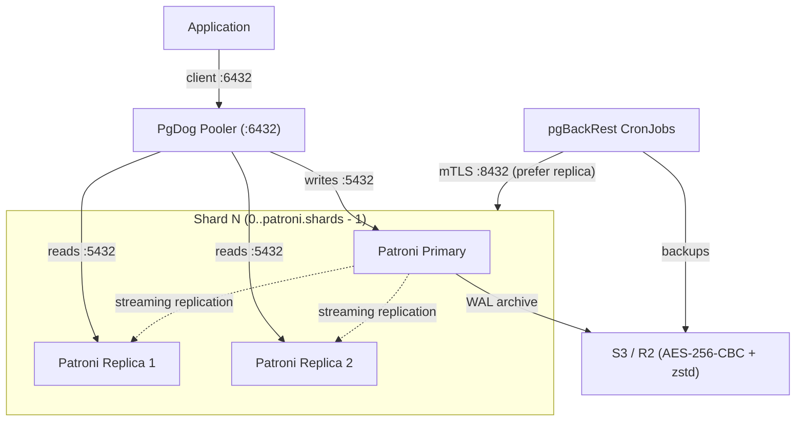

# PostgreSQL Cluster

High-availability PostgreSQL 18 Helm chart with Patroni failover, PgDog connection pooling and
sharding, pgBackRest S3 backups, and Prometheus/Grafana monitoring.

[Architecture](#architecture) · [Quick Start](#quick-start) · [Connecting](#connecting) ·
[Operations](#operations) · [Upgrading to 0.1.7](#upgrading-to-017) ·
[Troubleshooting](#troubleshooting) · [Local Development](#local-development) ·
[Configuration](#configuration)

## Architecture



- **Patroni** — PostgreSQL 18 across `patroni.shards` shards (`patroni.replicasPerShard` pods each)
  with async streaming replication, Kubernetes Endpoints leader election (routing primary service
  `<db>-shard-<N>` directly to the leader), `Parallel` pod management, a 600s termination grace
  period, and hard per-shard node anti-affinity. Bundles `pg_cron`, `pgvector`, `PostGIS`, and
  `pg_stat_statements`. Fresh bootstrap creates only `pg_stat_statements` in the app database;
  create the others as superuser when needed.
- **PgDog** — Deployed as k3s `HelmChart` `<namespace>-<db>-pgdog` in `kube-system` behind service
  `<db>-pgdog`. Handles transaction pooling, primary/replica detection via `pg_is_in_recovery()`,
  read/write splitting, `least_active_connections` balancing, and hash sharding via
  `pgdog.shardedTables`.
- **pgBackRest** — Per-shard stanzas (`<db>-shard-<N>`) with scheduled `full`/`diff`/`incr` mTLS
  backups preferring replicas, `aes-256-cbc` + `zstd` S3-compatible storage, continuous WAL
  archiving, and restore-on-bootstrap when a stanza already has a full backup (keeping the chart's
  `postgresql.conf` and `pg_hba.conf`, dropping the backup's `ALTER SYSTEM` settings, retrying repo
  errors every 10s until WAL replay finishes, taking a retrying full backup for replicas, resuming
  both across container restarts before Patroni starts, and failing bootstrap instead of starting
  empty if the repo cannot be read).
- **Monitoring** — `postgres-exporter` sidecar on each Patroni pod, `ServiceMonitor`s for Patroni,
  PostgreSQL, and PgDog, and Grafana dashboard ConfigMap
  `grafana-dashboard-postgres-<namespace>-<db>` (label `grafana_dashboard: "1"`).

## Quick Start

Examples below use `myapp` as both the Kubernetes namespace and `db` name. The cluster needs these
prerequisites, all pre-installed by [k3s](../../k3s/README.md):

- `patroni` ClusterRole ([k3s/base/core/postgres.yaml](../../k3s/base/core/postgres.yaml))
- Prometheus Operator CRDs for `ServiceMonitor`s
- `internal-ca-issuer` ClusterIssuer
  ([k3s/base/core/cert-manager.yaml](../../k3s/base/core/cert-manager.yaml)), required when
  `backup.enabled: true`

### 1. Create Secrets

In `apps/myapp/kube/`, declare the `myapp` Namespace in `namespaces.yaml` so Kustomize creates it
before applying `credentials.yaml` (`HelmChart`'s `createNamespace: true` runs asynchronously in
helm-controller), and list both files in `kustomization.yaml`. Populate `${...}` placeholders from
[infra/secrets.ts](../../infra/secrets.ts) (full example:
[apps/example/kube/credentials.yaml](../../apps/example/kube/credentials.yaml)):

- **`postgres-myapp-creds`** (`credentials.secret`) — `SUPERUSER_PASSWORD`, `ADMIN_PASSWORD`,
  `CLIENT_PASSWORD`, `REPLICATION_PASSWORD`, `PATRONI_PASSWORD`, plus the `users.toml` key below
  (mounted directly by PgDog)
- **`backup-bucket-creds`** (`backup.credentials.secret`, required when `backup.enabled: true`) —
  `S3_ACCESS_KEY`, `S3_SECRET_KEY`

```toml
[[users]]
name = "admin"
database = "myapp"
password = "<ADMIN_PASSWORD>"

[[users]]
name = "client"
database = "myapp"
password = "<CLIENT_PASSWORD>"
```

### 2. Deploy with HelmChart

```yaml
# apps/myapp/kube/postgres.yaml
apiVersion: helm.cattle.io/v1
kind: HelmChart
metadata:
  name: myapp-postgres-myapp-cluster
  namespace: kube-system
spec:
  chart: oci://${ImageRegistry}/charts/postgres
  version: 0.1.7
  targetNamespace: &namespace myapp
  createNamespace: true
  failurePolicy: abort
  plainHTTP: ${IsLocal}
  set:
    db: myapp
    namespace: *namespace
    credentials.secret: postgres-myapp-creds
    backup.path: /kubernetes/myapp/postgres
    backup.image: ${ImageRegistry}/pgbackrest:${ImageTag}
    patroni.image: ${ImageRegistry}/patroni:${ImageTag}
```

Add the manifest to `apps/myapp/kube/kustomization.yaml` and `apps/myapp/kube` to
[k3s/base/apps/kustomization.yaml](../../k3s/base/apps/kustomization.yaml) (full example:
[apps/example/kube/postgres.yaml](../../apps/example/kube/postgres.yaml)). Deploy `local` or `dev`
with `pnpm cluster deploy` (see [scripts/cluster/README.md](../../scripts/cluster/README.md#deploy)
for commands and [Template Variables](../../scripts/cluster/README.md#template-variables) for
`${ImageRegistry}`, `${ImageTag}`, `${IsLocal}`, and Pulumi outputs), or merge to `main` for ArgoCD
to sync `prod` ([k3s/README.md](../../k3s/README.md#argocd-prod)).

> [!WARNING]
>
> - Set `backup.enabled` before first deploy — Patroni ignores later `archive_mode` changes.
> - Chart defaults target local k3d S3Mock with a placeholder encryption key; for cloud clusters,
>   override `backup.bucket`, `backup.encryptionKey`, and `s3.*` (see [Values](#values)).

To pin Patroni to dedicated `role=db` nodes in `dev` and `prod` (local k3d has no `role=db` nodes),
add `apps/myapp/kube/cluster-patch.yaml` and list it under `patches` in
[k3s/overlays/cluster/kustomization.yaml](../../k3s/overlays/cluster/kustomization.yaml):

```yaml
# apps/myapp/kube/cluster-patch.yaml
apiVersion: helm.cattle.io/v1
kind: HelmChart
metadata:
  name: myapp-postgres-myapp-cluster
  namespace: kube-system
spec:
  set:
    nodeSelector.role: db
    tolerations[0].key: role
    tolerations[0].operator: Equal
    tolerations[0].value: db
    tolerations[0].effect: NoSchedule
```

### 3. Configure Sharding (Optional)

Add `patroni.shards` and `pgdog.shardedTables` to `apps/myapp/kube/postgres.yaml`:

```yaml
spec:
  set:
    patroni.shards: 3
  valuesContent: |-
    pgdog:
      shardedTables:
        - database: myapp
          name: users
          column: id
          dataType: bigint
```

Supported `dataType` values: `bigint`, `uuid`, `varchar`, `vector`.

## Connecting

**Application (via PgDog)** — URI: `postgresql://client:<CLIENT_PASSWORD>@myapp-pgdog:6432/myapp`

```sh
kubectl -n myapp exec -it deploy/myapp -- \
  psql -h myapp-pgdog -p 6432 -U client -d myapp
```

**Admin (direct to a shard's primary — service `myapp-shard-0:5432`, or inside the current leader
pod from [`patronictl list`](#check-cluster-status)):**

```sh
kubectl -n myapp exec -it patroni-myapp-shard-0-0 -c patroni -- \
  psql -U admin -d myapp
```

### Users & Permissions

Remote PostgreSQL logins are restricted to the pod CIDR (`10.42.0.0/16`) with `scram-sha-256` (see
`pg_hba` in [patroni.yaml](./chart/files/patroni.yaml)):

| User         | Purpose               | Access                                                                                                              |
| ------------ | --------------------- | ------------------------------------------------------------------------------------------------------------------- |
| `postgres`   | Superuser             | Local socket and loopback (all DBs); remote `postgres` DB only                                                      |
| `admin`      | Schema migrations     | Remote app DB; `CONNECT` on app DB, `CREATE` on `public` (owns objects it creates)                                  |
| `client`     | Application queries   | Remote app DB; `CONNECT`, `TEMPORARY`, `USAGE` on `public`, default DML/sequence/function grants on `admin` objects |
| `replicator` | Streaming replication | Remote replication and `postgres` DB                                                                                |
| `patroni`    | Patroni REST API      | HTTP Basic auth on `:8008` (not a PostgreSQL role)                                                                  |

## Operations

### Check Cluster Status

Patroni cluster state for shard 0 (repeat per shard):

```sh
kubectl -n myapp exec patroni-myapp-shard-0-0 -c patroni -- \
  patronictl -c /etc/patroni/patroni.yaml list
```

PgDog detected roles:

```sh
kubectl -n myapp exec deploy/myapp-pgdog -- \
  curl -s http://127.0.0.1:9090/metrics | grep "role="
```

### Manual Switchover

```sh
kubectl -n myapp exec patroni-myapp-shard-0-0 -c patroni -- \
  patronictl -c /etc/patroni/patroni.yaml switchover \
  --leader patroni-myapp-shard-0-0 \
  --candidate patroni-myapp-shard-0-1 \
  --force
```

### Backup Operations

Trigger a manual backup (swap `-full` for `-diff` or `-incr`):

```sh
kubectl -n myapp create job --from=cronjob/myapp-shard-0-pgbackrest-backup-full manual-backup
```

Check backup status (add `--output=json` for machine-readable output):

```sh
kubectl -n myapp exec patroni-myapp-shard-0-0 -c patroni -- \
  pgbackrest --stanza=myapp-shard-0 info
```

### Scaling Replicas

No data migration required (each pod in a shard needs its own node due to `podAntiAffinity`).

**Scale up:**

1. Increase `patroni.replicasPerShard` (for example, `3` to `5`), redeploy, and wait for new
   replicas to clone (via pgBackRest, falling back to `pg_basebackup`) and become `Ready`
   (`kubectl -n myapp get pods -w`).
2. Wait for the `myapp-pgdog` ConfigMap (`pgdog.toml`) to list the new pods, then restart PgDog as
   in [Adding Shards (Scale Up)](#adding-shards-scale-up), Step 3 so it routes reads to them.

**Scale down** (Kubernetes terminates the highest-ordinal pods first, in parallel):

1. In every shard, check the leader (`patronictl list`) and run
   [Manual Switchover](#manual-switchover) if a pod being removed leads it.
2. Lower `patroni.replicasPerShard` and redeploy.
3. Wait for the `myapp-pgdog` ConfigMap (`pgdog.toml`) to drop the removed pods, then restart PgDog
   as in [Adding Shards (Scale Up)](#adding-shards-scale-up), Step 3 so it does not ban the removed
   hosts and shift reads to the primary.
4. Delete the kept PVCs (`patroni-data-<pod>` and `patroni-wal-archives-<pod>`) if you will not
   scale back up.

### Scaling Shards

> [!CAUTION]
> PgDog hashes keys across `patroni.shards`, so changing the shard count remaps existing keys.
> **Before adding or removing shards**, stop all app reads, writes, and background jobs, export
> schema, data, and sequences from every shard to external storage, and verify the export. Keep
> traffic stopped until reload and validation succeed.

This chart does not provision the prerequisites for PgDog's
[online resharding](https://docs.pgdog.dev/features/sharding/resharding/), so both procedures below
need downtime.

#### Adding Shards (Scale Up)

1. **Update Helm values and redeploy.** Increase `patroni.shards` (for example, `3` to `4`) and
   redeploy (see [scripts/cluster/README.md](../../scripts/cluster/README.md#deploy), or merge to
   `main` for prod ArgoCD sync) to create `myapp-shard-3`'s StatefulSet, services, certificates, and
   backup CronJobs.

2. **Verify the new shard.** Wait for its pods to become `Ready`:

   ```sh
   kubectl -n myapp get pods -l cluster-name=myapp-shard-3 -w
   ```

   Then check Patroni cluster health:

   ```sh
   kubectl -n myapp exec patroni-myapp-shard-3-0 -c patroni -- \
     patronictl -c /etc/patroni/patroni.yaml list
   ```

3. **Restart PgDog.** Wait for the `myapp-pgdog` ConfigMap (`pgdog.toml`) to list the new shard set
   — PgDog pods do not reload on config changes:

   ```sh
   kubectl rollout restart deploy/myapp-pgdog -n myapp
   kubectl rollout status deploy/myapp-pgdog -n myapp
   ```

   Wait for the old PgDog pods to terminate before reloading data, so every serving instance uses
   the new shard set (`kubectl -n myapp get pods -l app.kubernetes.io/name=pgdog`).

4. **Reload and validate data** (keep traffic stopped and retain the export until validated):
   - Match the schema on every destination shard.
   - Clear existing application table rows on all destination shards (new shards restore old backups
     if their stanza has one).
   - Re-insert the full export through PgDog with the new shard count.
   - Preserve unsharded/replicated tables and restore sequence state.
   - Verify row counts, key-based reads/writes through PgDog, and replica catch-up before resuming
     traffic.

#### Removing Shards (Scale Down)

Export every shard with traffic stopped first — removing shards remaps keys on retained shards too.

1. **Update Helm values, verify remaining shards, and restart PgDog:**
   - Lower `patroni.shards` (for example, `4` to `3`) and redeploy.
   - Verify the remaining shards are healthy (`patronictl list`).
   - Wait for the `myapp-pgdog` ConfigMap (`pgdog.toml`) to drop the removed shard, then restart
     PgDog as in [Adding Shards (Scale Up)](#adding-shards-scale-up), Step 3.

2. **Reload and validate data.** Clear old table data on the remaining shards, re-insert the export
   through PgDog, restore sequences, and validate as in
   [Adding Shards (Scale Up)](#adding-shards-scale-up), Step 4 before resuming traffic.

3. **Clean up leftover resources.** Helm removes the shard's StatefulSet, services, certificates,
   and backup CronJobs, leaving Patroni's `-config` service and endpoints (and possibly the leader
   endpoints if Patroni rewrote them during shutdown), cert-manager TLS secrets, and PVCs behind.
   Delete the leftover services, endpoints, and TLS secrets:

   ```sh
   kubectl delete service,endpoints myapp-shard-3 myapp-shard-3-config -n myapp --ignore-not-found
   kubectl delete secret patroni-myapp-shard-3-tls myapp-shard-3-pgbackrest-backup-tls -n myapp
   ```

   Destructive — delete the shard's PVCs (removes all shard data on disk):

   ```sh
   kubectl delete pvc -n myapp -l cluster-name=myapp-shard-3
   ```

   The shard's backups remain in S3 under stanza `myapp-shard-3`.

### Point-in-Time Recovery (PITR)

> [!WARNING]
> Each shard has its own stanza (`<db>-shard-<N>`) and can be restored independently, but restoring
> one shard to a different point in time skews sharded tables across shards.

#### Step 1: Identify Target Time

```sh
kubectl -n myapp exec patroni-myapp-shard-0-0 -c patroni -- \
  pgbackrest --stanza=myapp-shard-0 info
```

Pick a timestamp between the oldest backup's completion time and the latest archived WAL in
`YYYY-MM-DD HH:MM:SS+TZ` format.

#### Step 2: Stop the Shard

```sh
kubectl -n myapp scale statefulset patroni-myapp-shard-0 --replicas=0
kubectl -n myapp wait --for=delete pod -l cluster-name=myapp-shard-0 --timeout=120s
```

#### Step 3: Prepare a Recovery Pod

Start a temporary recovery pod from the StatefulSet's `patroni` container spec with pod 0's PVCs
mounted (inheriting the same env, config, and volumes) and open a shell in it:

```sh
kubectl -n myapp get statefulset patroni-myapp-shard-0 -o json | jq '. as $sts | {
  apiVersion: "v1",
  kind: "Pod",
  metadata: { name: "pitr-restore", namespace: .metadata.namespace },
  spec: (.spec.template.spec
    | .containers |= map(select(.name == "patroni") | .args = ["sleep", "infinity"] | del(.readinessProbe))
    | .volumes += [$sts.spec.volumeClaimTemplates[].metadata.name
        | { name: ., persistentVolumeClaim: { claimName: "\(.)-\($sts.metadata.name)-0" } }])
}' | kubectl apply -f -

kubectl -n myapp wait --for=condition=Ready pod/pitr-restore --timeout=120s
kubectl -n myapp exec -it pitr-restore -- bash
```

#### Step 4: Run pgBackRest Restore

Inside `pitr-restore`, run `pgbackrest restore` (`delta=y` in `pgbackrest.conf` overwrites the data
directory in place; the `restore_command` retries while the repo is unreachable, ending replay only
on a missing segment):

```sh
pgbackrest --stanza=myapp-shard-0 \
  --type=time \
  --target="2024-01-15 14:30:00+00" \
  --target-action=promote \
  --recovery-option="restore_command=until pgbackrest --stanza=myapp-shard-0 archive-get %f \"%p\"; do [ \$? -eq 1 ] && exit 1; sleep 10; done" \
  restore
```

<details>
<summary>Other recovery targets</summary>

Swap `--type` and `--target` above (omit `--target` for `--type=immediate`, and omit both `--target`
and `--target-action` for `--type=default`):

| Recovery option                        | Behavior                                                         |
| -------------------------------------- | ---------------------------------------------------------------- |
| `--type=time --target="TIMESTAMP"`     | Restore to a specific timestamp                                  |
| `--type=xid --target="TRANSACTION_ID"` | Restore to a specific transaction                                |
| `--type=lsn --target="WAL_LSN"`        | Restore to a specific WAL position                               |
| `--type=immediate`                     | Stop as soon as the backup is consistent (no further WAL replay) |
| `--type=default`                       | Restore and replay all available archived WAL                    |

</details>

Delete the backup's cached Patroni config (`patroni.dynamic.json`) so Patroni does not load stale
settings into the DCS once Step 5 deletes `-config`, then start PostgreSQL inside `pitr-restore` to
replay to the target and promote before Patroni starts (Patroni drops pgBackRest's recovery target
from `postgresql.auto.conf`; `-o` clears any replica apply delay and disables `hot_standby` so a
higher `max_connections` from the backup does not halt replay; `-W` avoids `pg_ctl`'s 60s wait
timeout):

```sh
rm -f /var/lib/postgresql/pgdata/patroni.dynamic.json
pg_ctl start -W -D /var/lib/postgresql/pgdata -l /tmp/pitr-restore.log -o '-c recovery_min_apply_delay=0 -c hot_standby=off'
```

Wait for PostgreSQL to reach the target and promote — the loop returns once promotion completes
(check `/tmp/pitr-restore.log` if it never does):

```sh
until [ "$(psql -Atq -d postgres -c 'SELECT pg_is_in_recovery()' 2> /dev/null)" = f ]; do sleep 5; done
```

Stop PostgreSQL cleanly:

```sh
pg_ctl stop -w -D /var/lib/postgresql/pgdata
```

#### Step 5: Restart the Shard

Exit the `pitr-restore` shell, then run the commands below on your host. Delete the recovery pod
(`--grace-period=1` skips the 600s grace period since PostgreSQL is already stopped) and Patroni's
Kubernetes Endpoints (`myapp-shard-0` and `myapp-shard-0-config`, required so the restored primary
starts on a new timeline):

```sh
kubectl -n myapp delete pod pitr-restore --grace-period=1
kubectl -n myapp delete endpoints myapp-shard-0 myapp-shard-0-config
```

Destructive — delete every replica's PVCs (`1` through `patroni.replicasPerShard - 1`), since their
data runs past the restore point and Patroni will not notice:

```sh
for pod in 1 2; do
  kubectl delete pvc -n myapp \
    "patroni-data-patroni-myapp-shard-0-${pod}" \
    "patroni-wal-archives-patroni-myapp-shard-0-${pod}"
done
```

Start the restored primary alone and take a full backup on its new timeline so replicas clone from
the restored state instead of a pre-restore backup:

```sh
kubectl -n myapp scale statefulset patroni-myapp-shard-0 --replicas=1
kubectl -n myapp rollout status statefulset/patroni-myapp-shard-0 --timeout=5m
kubectl -n myapp create job pitr-full --from=cronjob/myapp-shard-0-pgbackrest-backup-full
kubectl -n myapp wait --for=condition=Complete job/pitr-full --timeout=30m
```

Scale the shard back up to `patroni.replicasPerShard`; replicas clone from the new backup (falling
back to `pg_basebackup`) and follow the new timeline (`recovery_target_timeline: latest`):

```sh
kubectl -n myapp scale statefulset patroni-myapp-shard-0 --replicas=3
kubectl -n myapp get pods -l cluster-name=myapp-shard-0 -w
```

#### Step 6: Verify Recovery

Check shard health:

```sh
kubectl -n myapp exec patroni-myapp-shard-0-0 -c patroni -- \
  patronictl -c /etc/patroni/patroni.yaml list
```

Confirm your data is at the expected point in time (replace `your_table` and column as needed):

```sh
kubectl -n myapp exec patroni-myapp-shard-0-0 -c patroni -- \
  psql -U postgres -d myapp -c "SELECT MAX(created_at) FROM your_table;"
```

### Upgrading to 0.1.7

> [!WARNING]
> Applies to any existing cluster running a chart version before `0.1.7` (such as `0.1.5` or
> `0.1.6`):
>
> - `0.1.7` sets the StatefulSets' immutable `podManagementPolicy: Parallel`, so upgrading fails
>   unless each shard's StatefulSet is orphan-deleted first.
> - The primary Service `patroni-<db>-primary-shard-<N>` is replaced by `<db>-shard-<N>`. Move any
>   direct connections over to `<db>-shard-<N>` (PgDog already connects directly to pod DNS).

Before upgrading from a chart version earlier than `0.1.7`, orphan-delete each shard's StatefulSet
(pods keep running and are adopted by the recreated StatefulSet, then rolled):

```sh
kubectl delete statefulset -n myapp patroni-myapp-shard-0 --cascade=orphan
```

Repeat for each shard (`0` through `patroni.shards - 1`), then deploy `0.1.7`.

## Troubleshooting

### Cluster Won't Start After Deletion

Stale Patroni Kubernetes Endpoints left from a previous release can block bootstrap with
`waiting for leader to bootstrap` in pod logs. Delete them for each affected shard (replace
`myapp-shard-0` as needed; `--ignore-not-found` handles leader endpoints already removed by
kube-controller-manager when the shard's service was deleted):

```sh
kubectl delete endpoints myapp-shard-0 myapp-shard-0-config -n myapp --ignore-not-found
```

The waiting pods bootstrap on their own once the endpoints are gone — do not restart them, as a pod
killed mid-bootstrap can come back leading an unrestored data directory. If the stanza still has a
full backup in S3, the new primary restores it during bootstrap.

### Backup Job Fails with TLS Error

Check that both per-shard certificates are `Ready`: `patroni-myapp-shard-<N>` and
`myapp-shard-<N>-pgbackrest-backup`. They are issued by `internal-ca-issuer` with the shard's
primary (`myapp-shard-<N>`) and replicas (`patroni-myapp-replicas-shard-<N>`) service hostnames as
`dnsNames`.

```sh
kubectl -n myapp get certificate
```

### Replication Lag

Run on the shard's current primary (returns no rows on replicas); for a shard-wide lag view from any
pod, use `patronictl list` in [Check Cluster Status](#check-cluster-status):

```sh
kubectl -n myapp exec patroni-myapp-shard-0-0 -c patroni -- \
  psql -U postgres -c "SELECT * FROM pg_stat_replication;"
```

### PgDog Not Routing to Replicas

Check live role detection with the PgDog metrics command in
[Check Cluster Status](#check-cluster-status), and confirm these chart defaults are not overridden:
`pgdog.lsnCheckDelay: 0`, `pgdog.lsnCheckInterval: 1000`, and
`pgdog.readWriteSplit: include_primary_if_replica_banned`.

## Local Development

Your host pushes images and charts to `localhost:12345`, and local k3d pulls them from
`local-registry:5000`. Run the scripts below inside `packages/postgres/`, or from the repo root via
`pnpm --filter @pandoks.com/postgres <script>` (`pnpm local:build && pnpm local:push` from the repo
root builds and pushes every package).

| Target                          | Build                         | Push                         |
| ------------------------------- | ----------------------------- | ---------------------------- |
| All                             | `pnpm local:build`            | `pnpm local:push`            |
| Patroni image                   | `pnpm local:build:patroni`    | `pnpm local:push:patroni`    |
| pgBackRest image                | `pnpm local:build:pgbackrest` | `pnpm local:push:pgbackrest` |
| Helm chart (`./postgres-*.tgz`) | `pnpm local:build:helm`       | `pnpm local:push:helm`       |

### End-to-End Tests

Run the Ginkgo suite in [e2e](./e2e) from the repo root with k3d up (see
[packages/e2e](../e2e/README.md#running-a-suite) for cluster setup and suite options):

1. Build and push this checkout's images (re-run after editing them):

   ```sh
   pnpm --filter @pandoks.com/postgres local:build && pnpm --filter @pandoks.com/postgres local:push
   ```

2. _(Apple Silicon only — run once, or when `main` changes)_ Build and push `main`'s images for the
   GHCR upgrade and revert specs (skip on `linux/amd64`):

   ```sh
   for image in patroni pgbackrest; do
     docker build -f "packages/postgres/${image}/Dockerfile" -t "localhost:12345/${image}:main" \
       https://github.com/Pandoks/pandoks.com.git#main
     docker push "localhost:12345/${image}:main"
   done
   ```

3. Run the suite (on `linux/amd64`, omit the `--previous-*` flags to use GHCR defaults; on an 8 GiB
   Docker VM, pass `--procs=3` instead of `-p`):

   ```sh
   go tool ginkgo -p ./packages/postgres/e2e -- \
     --patroni-image=local-registry:5000/patroni:latest \
     --pgbackrest-image=local-registry:5000/pgbackrest:latest \
     --previous-patroni-image=local-registry:5000/patroni:main \
     --previous-pgbackrest-image=local-registry:5000/pgbackrest:main
   ```

## Configuration

### Values

Full defaults live in [values.yaml](./chart/values.yaml). Keys that must be overridden or have
non-obvious behavior:

| Key                            | Default                            | Notes                                                                            |
| ------------------------------ | ---------------------------------- | -------------------------------------------------------------------------------- |
| `credentials.secret`           | `postgres-example-creds`           | Must hold the 5 password keys and PgDog's `users.toml`                           |
| `backup.enabled`               | `true`                             | Set before first deploy; Patroni ignores later `archive_mode` changes            |
| `backup.bucket`                | `backups`                          | Override in cloud clusters (for example, `${BackupBucket}`)                      |
| `backup.path`                  | `/kubernetes/examples/postgres`    | Must be unique per cluster within the bucket                                     |
| `backup.encryptionKey`         | `openssl-rand-hex-32`              | Placeholder — override in cloud clusters                                         |
| `backup.schedules.*`           | `full` / `diff` / `incr` crons     | Set a schedule to `""` to disable that CronJob                                   |
| `s3.*`                         | Local S3Mock (`:9191`, `tls: 'n'`) | Override `host`, `region`, `tls` (`'y'`/`'n'`), and `uriStyle` for cloud S3/R2   |
| `patroni.shards`               | `1`                                | Changing shard count remaps PgDog hashes; see [Scaling Shards](#scaling-shards)  |
| `patroni.replicasPerShard`     | `3`                                | Includes the primary (`1 primary + n - 1 replicas`); each pod needs its own node |
| `nodeSelector` / `tolerations` | `~`                                | Applied only to Patroni pods; PgDog stays with application nodes                 |

All `pgdog.*` keys pass through to the upstream
[PgDog chart](https://github.com/pgdogdev/helm/blob/main/values.yaml), except `fullnameOverride`,
`serviceMonitor`, `externalSecrets`, and `databases`, which this chart manages.

### Ports

| Port   | Service           | Purpose                          |
| ------ | ----------------- | -------------------------------- |
| `5432` | PostgreSQL        | Database connections             |
| `6432` | PgDog             | Connection pooler                |
| `8008` | Patroni REST API  | Health checks, failover, metrics |
| `8432` | pgBackRest        | Backup mTLS server               |
| `9090` | PgDog             | OpenMetrics                      |
| `9187` | postgres-exporter | PostgreSQL metrics               |

---

Docs: [PostgreSQL](https://www.postgresql.org/docs/) · [Patroni](https://patroni.readthedocs.io/) ·
[PgDog](https://docs.pgdog.dev/) · [pgBackRest](https://pgbackrest.org/user-guide.html)
