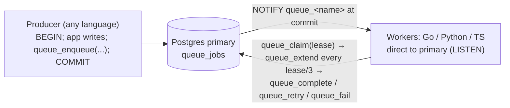

# Queue

A job queue in the app's Postgres, shared by Go, Python, and TypeScript workers. One `queue_jobs`
table and a set of SQL functions in [queue.sql](./queue.sql) hold every rule: the lease, retry
backoff, attempt limit, fencing, and wake-up. Each client is a thin layer over its usual driver
([pgx](https://github.com/jackc/pgx), [psycopg](https://www.psycopg.org/psycopg3/),
[pg](https://node-postgres.com/)) that waits, claims, heartbeats, runs, and reports. There is no
extension, sidecar, or extra service.



## Rules

- **Lease:** a claim marks the job `running` until `now() + lease`. A worker that dies stops
  heartbeating, so its job runs again on another worker once the lease ends.
- **Heartbeat:** while the handler runs, the client extends the lease every `lease / 3`. Go cancels
  the handler's context when the lease is lost. Python and TS can't stop a running handler, so they
  only log it, and the handler's side effects can happen twice.
- **Shutdown:** when Go's `Run` stops, it cancels the running handlers. A job whose handler returns
  `context.Canceled` goes back to the queue with its attempt unspent (`queue_release`). A Python or
  TS worker that exits mid-job is a crash: the job runs again after its lease, on a spent attempt.
- **Fencing:** every report carries the attempt it claimed. Once another worker claims the job, the
  first worker's extend, complete, retry, and fail return false and change nothing.
- **Retry:** a handler error retries after `2^(attempt-1)` seconds, at most an hour, or after
  `RetryAfter`'s delay, `0` retrying at once. `Permanent` errors, and the failure of the last
  attempt (5 by default), mark the job `dead`. A job whose worker dies on its last attempt is marked
  dead by the next claim.
- **Cancel:** deletes a queued job, or a running one whose lease ran out. A job a worker still runs
  finishes this run, and its retry, release, or lost lease then deletes it instead of running it
  again.
- **History:** a completed or cancelled job is deleted. Dead rows stay in `queue_jobs` for a human
  to inspect, and logs are the only record of successes.
- **Wake-up:** a trigger runs `pg_notify('queue_<name>')` whenever a row becomes `queued`, so it
  fires at commit and a rolled-back enqueue wakes nobody. An idle worker otherwise sleeps until the
  queue's next due job or lease end, at least 0.1 s and at most one lease.

## SQL API

Every client calls these, so a producer can also call them straight from SQL.

| Function                                                                           | Returns                                                             |
| ---------------------------------------------------------------------------------- | ------------------------------------------------------------------- |
| `queue_enqueue(queue, payload jsonb, run_at, group_key, max_attempts)`             | job id; the last three may be `NULL`                                |
| `queue_claim(queue, worker, lease_seconds)`                                        | the claimed `queue_jobs` row, or no row                             |
| `queue_extend(id, attempt, lease_seconds)`                                         | false once the lease is lost                                        |
| `queue_complete(id, attempt)`                                                      | false once the lease is lost; deletes the job                       |
| `queue_retry(id, attempt, error, retry_after_s)`, `queue_fail(id, attempt, error)` | false once the lease is lost                                        |
| `queue_release(id, attempt)`                                                       | false once the lease is lost; requeues without spending the attempt |
| `queue_cancel(id)`, `queue_cancel_group(queue, group_key)`                         | whether, or how many, jobs it deleted or marked cancelled           |
| `queue_wait_seconds(queue, max_seconds)`                                           | how long an idle worker waits                                       |

## Clients

|                            | Go (`queue`)                                                                     | Python (`pandoks_queue`)                                          | TS (`@pandoks.com/queue`)                                       |
| -------------------------- | -------------------------------------------------------------------------------- | ----------------------------------------------------------------- | --------------------------------------------------------------- |
| Enqueue                    | `Enqueue(ctx, db, queue, payload, EnqueueOptions{RunAt, GroupKey, MaxAttempts})` | `enqueue(db, queue, payload, run_at=, group_key=, max_attempts=)` | `enqueue(db, queue, payload, { runAt, groupKey, maxAttempts })` |
| Cancel                     | `Cancel`, `CancelGroup`                                                          | `cancel`, `cancel_group`                                          | `cancel`, `cancelGroup`                                         |
| Finish in your transaction | `job.Complete(ctx, tx)`                                                          | `job.complete(db)`                                                | `complete(db, job)`                                             |
| Errors                     | `Permanent(err)`, `RetryAfter(d, err)`                                           | `Permanent(msg)`, `RetryAfter(seconds, msg)`                      | `Permanent(msg)`, `RetryAfter(seconds, msg)`                    |
| Worker                     | `Worker{Pool, Queue, Name, Lease, Concurrency, Handle}.Run(ctx)`                 | `work(conninfo, queue, worker, handle, lease=30)`                 | `work(client, queue, worker, handle, lease = 30)`               |
| Schema                     | `Migrate(ctx, conn)` runs the embedded `queue.sql`                               | none                                                              | none                                                            |

Enqueue inside the caller's transaction to commit the job with its writes. To commit a job's end
with the handler's writes and follow-up jobs, call `Complete` in the handler's transaction and roll
it back if it returns false. Once it returns true, the runner doesn't report the job again.

`Run` and `work` return or raise when the database fails. A Go caller that serves other traffic
restarts `Run` in a loop; Python and TS workers exit and Kubernetes restarts them. When `Run`'s
context ends, it cancels the handlers' contexts but keeps heartbeating until they return.

```go
// Producer, in the app's transaction
if _, err := queue.Enqueue(ctx, tx, "thumbnails", map[string]string{"image_id": id}, queue.EnqueueOptions{}); err != nil {
	return err
}

// Worker; PG* variables, PGHOST the Patroni primary since LISTEN needs a session
pool, err := pgxpool.New(ctx, "pool_max_conns=6") // Concurrency + 2, since every handler holds a transaction
if err != nil {
	return err
}
worker := queue.Worker{Pool: pool, Queue: "thumbnails", Name: os.Getenv("HOSTNAME"), Concurrency: 4,
	Handle: func(ctx context.Context, job *queue.Job) error {
		var payload struct{ ImageID string `json:"image_id"` }
		if err := json.Unmarshal(job.Payload, &payload); err != nil {
			return queue.Permanent(err)
		}
		return resize(ctx, payload.ImageID)
	}}
return worker.Run(ctx)
```

```python
import os
from pandoks_queue import Permanent, RetryAfter, work

def handle(job):
    image_id = job.payload.get("image_id")
    if image_id is None:
        raise Permanent("payload has no image_id")
    response = resize(image_id)
    if response.status_code == 429:
        raise RetryAfter(float(response.headers["retry-after"]), "rate limited")

work("", "thumbnails", os.environ["HOSTNAME"], handle)  # "" reads the PG* variables
```

```ts
import pg from 'pg';
import { Permanent, work } from '@pandoks.com/queue';

const client = new pg.Client(); // reads the PG* variables
await client.connect();
await work(client, 'thumbnails', process.env.HOSTNAME!, async (job) => {
  if (typeof job.payload.image_id !== 'string') throw new Permanent('payload has no image_id');
  await resize(job.payload.image_id);
});
```

## Constraints

- **Connect workers to the Patroni primary, not PgDog**, since LISTEN needs a session. Producers may
  go through PgDog: every client call starts with `/* pgdog_role: primary */`, which PgDog's docs
  say routes it to the primary (untested here).
- **Connections:** a Go worker's pool needs at least 2 connections, or `Run` returns an error.
  LISTEN holds 1, and claims, heartbeats, reports, and the handlers share the rest, so size the pool
  for what the handlers hold at once plus 1: `Concurrency + 2` when every handler holds a
  transaction. A heartbeat that can't get a connection gives up after one lease and counts as a lost
  lease. A Python or TS worker uses 1 connection for LISTEN, claims, heartbeats, and reports, runs 1
  job at a time, and its handler writes through a connection of its own.
- **Queue names** are at most 57 bytes: a longer one fails `queue_enqueue`, since the channel
  `queue_<name>` must fit Postgres's 63-byte limit.
- **Schema:** `Migrate` runs as `admin` on the primary before the app's own DDL, from the app's
  migrate step. It takes an advisory lock and uses only `IF NOT EXISTS` and `CREATE OR REPLACE`, so
  every pod start reruns it safely. Its `CREATE INDEX` and `CREATE TRIGGER` lock `queue_jobs` even
  when nothing changes, and every queue write waits behind them, so after 10 s behind an open
  transaction it fails (`lock_timeout`) and the migrate init container restarts. Keep later changes
  additive in the same style (`ADD COLUMN IF NOT EXISTS`, `DROP FUNCTION IF EXISTS` before a
  signature changes); there is no migrations table. Only the Go client migrates; a database with
  only Python or TS consumers would add one that runs `queue.sql`.
- **TS ships as `.ts`.** Node strips its types through pnpm's workspace symlink but refuses a copy
  under `node_modules` (`ERR_UNSUPPORTED_NODE_MODULES_TYPE_STRIPPING`), so a TS worker image keeps
  the workspace layout or compiles; `pnpm deploy`-style copies don't work.

## Tests

`queue_test.go` covers the SQL rules once; the Python and TS tests cover only each client's own
error mapping, heartbeat, wake-up channel, and in-transaction `complete`. They need a Postgres that
the `PG*` variables reach, and each test empties its own queues first:

```sh
docker run -d --rm --name queue-test -p 5432:5432 -e POSTGRES_PASSWORD=postgres postgres:18-trixie
PGHOST=localhost PGUSER=postgres PGPASSWORD=postgres mise exec -- pnpm --filter @pandoks.com/queue test
docker stop queue-test
```
