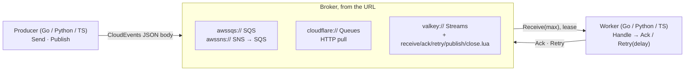

# Queue

Queues and pub/sub over SQS and SNS, Cloudflare Queues, or Valkey, chosen by URL, with the same
interface natively in Go (`queue`), Python (`pandoks_queue`), and TypeScript (`@pandoks.com/queue`).
Every broker carries one wire format, a
[CloudEvents 1.0](https://github.com/cloudevents/spec/blob/main/cloudevents/spec.md) JSON envelope,
so a Go producer, a Python worker, and a TS worker can share a queue. Each language talks to the
broker through its official SDK; there is no sidecar or proxy.



## Rules

- **Envelope:** the message body on every broker is a CloudEvents 1.0 structured JSON envelope
  (`specversion`, `id`, `source`, `type`, `time`, `datacontenttype`, then `data` or `data_base64`),
  sent as UTF-8 text. JSON content types (`application/json`, `*+json`, read after trimming spaces
  and tabs and lowercasing ASCII only) put the data in `data`; anything else goes canonical base64
  (padded, no line breaks) in `data_base64`, and an envelope with the other member is malformed.
  Extensions are top-level string members named `[a-z0-9]{1,20}`; every attribute is a string of
  valid Unicode (no lone UTF-16 surrogate), never `null`, and a missing `datacontenttype` reads as
  `application/json`. Numbers in `data` must fit a float64 (no `NaN`, `Infinity`, or `1e400`).
  `time` is written as UTC with milliseconds (`2026-11-09T18:00:00.123Z`) in every language, and
  read only as RFC 3339 with an offset. Encoders escape U+FFFE and U+FFFF, which SQS rejects raw
  (Moto accepts them). [testdata/envelopes](./testdata/envelopes) holds the golden envelopes each
  language decodes and re-encodes, and [testdata/malformed](./testdata/malformed) bodies every
  language rejects.
- **Size:** `Send` and `Publish` reject an envelope over 120,000 bytes on every broker, so a payload
  that works on SQS also fits Cloudflare's 128 KB. Each language measures its own encoding: Go keeps
  escapes in JSON `data` as written (like `\u00e9`), while Python and TS re-encode `data`, so the
  same message can measure differently. Store anything bigger in object storage and send a
  reference.
- **At-least-once:** every broker can deliver a message twice, and no broker fences a late ack.
  Valkey skips a late retry of a delivery whose lease expired and was received again. Handlers
  dedupe on the envelope `id`, which the producer chooses (random when empty) and should make stable
  for retried sends.
- **Lease:** `Receive` leases each delivery for the URL's `lease`. `Deadline` is when it ends; past
  it the broker redelivers. Set the lease above the handler's worst case plus 10 s; no broker here
  can extend one portably.
- **Attempts:** `Attempt` is 1 on the first delivery and comes from the broker (SQS's
  `ApproximateReceiveCount` is approximate).
- **Retry:** `Retry(delay)` releases the delivery to come back after `delay`, which, like `Send`'s
  `Delay`, is at most 15 min (`MaxDelay`, SQS's ceiling). SQS and Cloudflare round delays up to
  whole seconds, and Valkey up to whole milliseconds. A zero `Delay` keeps the queue's own default
  delay on SQS (its `DelaySeconds` attribute) and Cloudflare (its `delivery_delay`), and is
  immediate on Valkey, which has none; a zero `Retry` delay is immediate on every broker. Valkey
  times delays on its server clock.
- **Dead letters:** after the broker's attempt limit a delivery moves to its dead-letter queue: SQS
  redrive `maxReceiveCount`, Cloudflare `max_retries` and `dead_letter_queue`, or Valkey's
  `max_attempts`, which writes to the `{<queue>}:dlq` stream.
- **Malformed bodies:** a body that isn't a valid UTF-8 envelope is logged and acked by `Receive`,
  not retried.
- **Topics:** a topic fans each message out to subscription queues, and each subscription is an
  ordinary queue with its own lease, retries, and dead letters. `Publish` takes no delay.

## Interface

Go is shown; Python and TS mirror it with their own naming (below).

```go
const MaxDelay = 15 * time.Minute
const MaxEnvelopeBytes = 120_000

type Message struct {
	ID, Source, Type string // ID empty → random; Source and Type required
	Data             []byte // JSON unless ContentType says otherwise
	ContentType      string // default application/json
	Extensions       map[string]string
	Delay            time.Duration // 0..MaxDelay
}

type Delivery struct {
	Message
	Time     time.Time // when it was sent
	Attempt  int
	Deadline time.Time // lease end
}

type Queue interface {
	Send(ctx context.Context, messages ...Message) error
	Receive(ctx context.Context, max int) ([]*Delivery, error)
	Ack(ctx context.Context, deliveries ...*Delivery) error
	Retry(ctx context.Context, delay time.Duration, deliveries ...*Delivery) error
	Close() error
}

type Topic interface {
	Publish(ctx context.Context, messages ...Message) error
	Close() error
}

func Open(ctx context.Context, url string) (Queue, error)      // a queue or a subscription
func OpenTopic(ctx context.Context, url string) (Topic, error)

type Worker struct {
	Queue       Queue
	Handle      func(context.Context, *Delivery) error
	Concurrency int
}
func (w Worker) Run(ctx context.Context) error
func Permanent(err error) error
func RetryAfter(delay time.Duration, err error) error
```

|            | Go                                     | Python                                         | TS                                                   |
| ---------- | -------------------------------------- | ---------------------------------------------- | ---------------------------------------------------- |
| Open       | `queue.Open(ctx, url)`, `OpenTopic`    | `open_queue(url)`, `open_topic(url)`           | `await openQueue(url)`, `openTopic`                  |
| Durations  | `time.Duration`                        | seconds (`float`)                              | seconds (`number`)                                   |
| Data       | `[]byte`                               | `bytes`                                        | `Uint8Array`                                         |
| Handler    | `func(ctx, *Delivery) error`           | `handle(delivery)`, raising to fail            | `async (delivery, signal) => {}`, throwing to fail   |
| Errors     | `Permanent(err)`, `RetryAfter(d, err)` | `Permanent(msg)`, `RetryAfter(seconds, msg)`   | `new Permanent(msg)`, `new RetryAfter(seconds, msg)` |
| Worker     | `Worker{…}.Run(ctx)`                   | `Worker(queue, handle, concurrency).run(stop)` | `new Worker({…}).run(signal)`                        |
| Runs on    | goroutines                             | a thread pool, with the sync SDKs              | promises                                             |
| Dependency | all SDKs in `go.mod`                   | extras `pandoks-queue[sqs,cloudflare,valkey]`  | optional peers, loaded by `import()` per URL scheme  |

**Worker:** it receives only as many deliveries as it has free slots (`Concurrency`). A handler that
returns is acked; `Permanent` is acked and logged; `RetryAfter` is retried after its delay (clamped
to 0 through `MaxDelay`; a `NaN` delay makes Python and TS raise instead); any other error, or a Go
panic, is retried after `2^(attempt-1)` s, at most 15 min. Go cancels the handler's context, and TS
aborts its signal, 10 s before `Deadline` (halfway there for a shorter lease); Python can't stop a
running handler, so it logs one that runs past that point. When the context, signal, or `stop` event
ends, the worker stops receiving, retries what its last receive returned with no delay instead of
handling it, Go and TS cancel the running handlers, and it returns once they have settled. A Python
worker can wait out its current receive first (up to SQS's 20 s long poll).

## URLs

Credentials come from each SDK's usual environment.

| Kind                | URL                                                                              | Notes                                                                          |
| ------------------- | -------------------------------------------------------------------------------- | ------------------------------------------------------------------------------ |
| SQS queue           | `awssqs://sqs.<region>.amazonaws.com/<account>/<name>?lease=2m[&endpoint=<url>]` | AWS default credential chain; `lease` in whole seconds                         |
| SNS topic           | `awssns:///arn:aws:sns:<region>:<account>:<name>[?endpoint=<url>]`               | Subscriptions are SQS queues subscribed with raw delivery on                   |
| Cloudflare queue    | `cloudflare://<account_id>/<queue_id>?lease=2m`                                  | `CLOUDFLARE_API_TOKEN` with Queues Edit; the queue needs an HTTP pull consumer |
| Cloudflare topic    | `cloudflare://<account_id>/<queue_id>,<queue_id>…`                               | Producer-side fan-out to each queue                                            |
| Valkey queue        | `valkey://[user:password@]<host>:<port>/<name>?lease=2m&max_attempts=5`          | Keys `{<name>}:stream`, `{<name>}:delayed`, `{<name>}:dlq`, `{<name>}:reclaim` |
| Valkey topic        | `valkey://[user:password@]<host>:<port>/<topic>`                                 | Fans out to `{<topic>}:subscriptions`                                          |
| Valkey subscription | `valkey://…/<topic>?subscription=<name>&lease=2m&max_attempts=5`                 | Opening one registers it in the topic's set                                    |

`lease` is `<n>ms`, `<n>s`, `<n>m`, or `<n>h`, at most 12 h, and required on every queue;
`max_attempts` is required on Valkey queues, from 1 to 2^63 - 1 in ASCII digits. Unknown parameters,
a `;` in the query, and malformed escapes (a `%` not followed by two hex digits, or escapes that
aren't UTF-8) in the query or a Valkey name, user, or password are errors. Only Valkey URLs take a
user and password, and they need the port. Every language rejects the URLs in
[testdata/malformed-urls.json](./testdata/malformed-urls.json) without echoing their passwords.

## Brokers

|                  | SQS + SNS                        | Cloudflare Queues, HTTP pull                        | Valkey Streams                                    |
| ---------------- | -------------------------------- | --------------------------------------------------- | ------------------------------------------------- |
| Send batch       | 10 messages, 1 MiB (SNS 256 KiB) | 100 messages, 256 KB                                | any, `send.lua`                                   |
| Receive          | 10, 20 s long poll               | 100, no long poll: an empty pull waits 1 s (billed) | any, `receive.lua`; an empty one waits 0.1 s      |
| Delay on send    | native, ≤ 15 min                 | native                                              | emulated: zset `{q}:delayed`, promoted on receive |
| Lease            | visibility timeout               | `visibility_timeout_ms`                             | emulated: `XAUTOCLAIM` after the lease            |
| Retry with delay | `ChangeMessageVisibility`        | `/ack` `retries[].delay_seconds`                    | emulated: `retry.lua`                             |
| Dead letters     | redrive policy                   | consumer `max_retries` + `dead_letter_queue`        | emulated: `{q}:dlq` stream at `max_attempts`      |
| Topic fan-out    | SNS → SQS, native                | none: `Publish` sends to each queue, not atomic     | emulated: `publish.lua`, atomic in one slot       |
| Local emulator   | Moto, ElasticMQ                  | none                                                | `valkey/valkey` container                         |

The six [Lua scripts](./valkey) are the Valkey adapter's only logic, and every language loads the
same files. A queue's keys share one hash tag, so a queue (or a topic with its subscriptions) lives
on one shard. Each receive runs one `XAUTOCLAIM`, which scans at most 10 × `max` leased entries from
the cursor the last receive stored in `{q}:reclaim`, so an expired lease behind N live ones comes
back within N / (10 × `max`) receives. `Close` removes the queue's consumer from the group unless it
still holds leases, which stay claimable; once a lease, a receive also removes every consumer that
holds none and hasn't received for a lease, like a crashed worker's. Valkey used as a queue needs
`persistence: aof` and replicas, and can still lose about a second of acknowledged writes on
failover. The chart's `client` user has the [grants](/packages/valkey/README.md#usersacl) the
scripts and cluster clients need.

Pick SQS for durable work (managed, long polls, native redrive and fan-out), Cloudflare for work
produced at the edge, and Valkey for cheap, high-rate in-cluster work that tolerates that loss.

**Not in the interface,** because the brokers can't do it the same way:

| Feature                                   | Instead                                                                                           |
| ----------------------------------------- | ------------------------------------------------------------------------------------------------- |
| Delays over 15 min, cancel by id          | Keep the record in the app's database and send it when due; check a cancelled flag in the handler |
| Extending a lease                         | Set `lease` above the handler's worst case (Cloudflare can't extend)                              |
| Ordering, FIFO groups, exactly-once       | Idempotent handlers keyed on the envelope `id`                                                    |
| Enqueue in a database transaction         | An outbox row the app sends after commit                                                          |
| Attributes outside the envelope, priority | Extensions in the envelope                                                                        |
| At-most-once broadcast to every live pod  | The Valkey client directly, with `+@pubsub` granted                                               |
| Creating queues and topics                | SST in `infra/`                                                                                   |

Kafka is planned once its share-group consumers are stable in the Go, Python, and JS clients; it has
no delayed delivery, so its adapter would reject a non-zero delay.

## Usage

```go
q, err := queue.Open(ctx, os.Getenv("THUMBNAILS_QUEUE_URL"))
if err != nil {
	return err
}
defer q.Close()
data, _ := json.Marshal(map[string]string{"image_id": id})
err = q.Send(ctx, queue.Message{ID: id, Source: "//pandoks.com/web", Type: "com.pandoks.thumbnail", Data: data})

worker := queue.Worker{Queue: q, Concurrency: 8, Handle: func(ctx context.Context, delivery *queue.Delivery) error {
	var payload struct{ ImageID string `json:"image_id"` }
	if err := json.Unmarshal(delivery.Data, &payload); err != nil {
		return queue.Permanent(err)
	}
	return resize(ctx, payload.ImageID)
}}
return worker.Run(ctx) // ctx from signal.NotifyContext(…, syscall.SIGTERM)
```

```python
import json, os, signal, threading
from pandoks_queue import Permanent, RetryAfter, Worker, open_queue

def handle(delivery):
    payload = json.loads(delivery.data)
    if "image_id" not in payload:
        raise Permanent("payload has no image_id")
    response = resize(payload["image_id"])
    if response.status_code == 429:
        raise RetryAfter(float(response.headers["retry-after"]), "rate limited")

stop = threading.Event()
signal.signal(signal.SIGTERM, lambda *_: stop.set())
Worker(open_queue(os.environ["THUMBNAILS_QUEUE_URL"]), handle, concurrency=8).run(stop)
```

```ts
import { Permanent, Worker, openQueue } from '@pandoks.com/queue';

const queue = await openQueue(process.env.THUMBNAILS_QUEUE_URL!);
const controller = new AbortController();
process.on('SIGTERM', () => controller.abort());
await new Worker({
  queue,
  concurrency: 8,
  handle: async (delivery, signal) => {
    const payload = JSON.parse(new TextDecoder().decode(delivery.data));
    if (typeof payload.image_id !== 'string') throw new Permanent('payload has no image_id');
    await resize(payload.image_id, signal);
  }
}).run(controller.signal);
```

## Constraints

- **TS ships as `.ts`** and loads the Lua scripts from `../valkey`, so a TS worker image keeps the
  workspace layout or compiles; `pnpm deploy`-style copies don't work. Python reads the same scripts
  relative to its source, so depend on it as an editable path dependency
  (`pandoks-queue = { path = "…/packages/queue/python", editable = true }` under
  `[tool.uv.sources]`); a built wheel has no Lua files.
- **TS `data` is parsed with `JSON.parse`,** so numbers past 2^53 lose precision; send them as
  strings.
- **Nesting:** an envelope nests at most 64 arrays and objects deep, counting itself, so `data`
  nests at most 63. `Send` and `Publish` reject deeper data and `Receive` acks deeper envelopes as
  malformed, so every language's parser stays within its stack.
- **Valkey clients** need the cluster's `client` ACL from chart 0.1.6 or later: valkey-go otherwise
  silently falls back to a single-node client.

## Tests

The same contract runs in each language against each broker: send, receive, and ack the golden
envelopes; a retry comes back after its delay as the next attempt; an expired lease redelivers;
dead-lettering after the last attempt; and a topic reaching every subscription. Each language also
tests its worker's settle rules and the exact requests it sends Cloudflare's API.
[compose.yaml](./compose.yaml) runs Moto (SQS and SNS) and a one-node Valkey cluster with the
chart's own `users.acl`, so the tests run as its `client` user:

```sh
docker compose -f packages/queue/compose.yaml up -d --wait
mise exec -- pnpm --filter @pandoks.com/queue test
docker compose -f packages/queue/compose.yaml down
```

Cloudflare has no emulator, so its contract runs only in CI (`test-queue-cloudflare` in
[tests.yaml](/.github/workflows/tests.yaml)), against queues the job creates for the run and deletes
afterwards. The job uses the repository's existing `CLOUDFLARE_API_TOKEN` and
`CLOUDFLARE_DEFAULT_ACCOUNT_ID` secrets, so that token needs Queues · Edit. Live runs show
`max_retries` 2 dead-letters after 3 deliveries: the third retry's ack answers with the warning
`Message has exhausted maxRetries`, which the adapters treat as success. Locally it is skipped
unless `CLOUDFLARE_ACCOUNT_ID`, `CLOUDFLARE_API_TOKEN`, and `QUEUE_TEST_CLOUDFLARE_QUEUE`, `_DLQ`,
and `_SUBSCRIPTION` (queue ids, the first dead-lettering to the second after `max_retries` 2) are
set.
